# Studio del caso: incidente in un impianto di cogenerazione

**Analisi dei fattori umani e organizzativi (HOF) - Technology Risk Governance (Prof. Trucco)**

Documento di studio per il gruppo. Obiettivo: capire teoria e caso abbastanza bene da poter compilare il minor da soli, e saper difendere ogni scelta fatta nel template.

---

## Indice

0. [Come usare questo documento e cosa chiede il minor](#0-come-usare-questo-documento-e-cosa-chiede-il-minor)
1. [Teoria](#1-teoria)
2. [Il caso](#2-il-caso)
3. [Come ha ragionato il prof sugli eventi 1 e 3](#3-come-ha-ragionato-il-prof-sugli-eventi-1-e-3)
4. [Guida evento per evento (E2, E4-E9)](#4-guida-evento-per-evento)
5. [Quali eventi scegliere](#5-quali-eventi-scegliere)
6. [Checklist finale ed errori tipici](#6-checklist-finale-ed-errori-tipici)
7. [Glossario IT/EN](#7-glossario-iten)

---

## 0. Come usare questo documento e cosa chiede il minor

### 0.1 Cosa chiede il minor (istruzioni date a fine lezione)

Il minor è **facoltativo** e consiste in un breve report con l'analisi di **4 eventi in totale**:

1. **Evento 1 ed Evento 3**: già analizzati insieme in aula. Vanno **completati e riassunti**.
2. **Altri 2 eventi a scelta** dalla timeline dell'incidente, analizzati da noi.

Per **ciascuno dei 4 eventi**:

- **1 pagina** con il template di Reason compilato (elenchi puntati, descrizioni brevi);
- **massimo 1 pagina** di giustificazioni: quali informazioni abbiamo preso dal testo del caso (e dalla discussione in aula) per compilare il template in quel modo.

Formato: Word o PowerPoint a scelta, ma la **consegna è obbligatoriamente in PDF**. Noi l'abbiamo fatto in LaTeX (file `minor_latex/`), quindi il PDF è già pronto.

> Il nostro minor contiene **tutti e 9 gli eventi** della timeline. Serve per scegliere: si tengono E1, E3 e i due eventi preferiti, e si escludono gli altri dal file principale prima di consegnare.

### 0.2 Come leggere il documento

- **Sezione 1 (Teoria)**: tutte le definizioni. Le parti in grassetto sono quelle che servono direttamente nel template.
- **Sezione 2 (Il caso)**: l'impianto, la fisica del colpo d'ariete spiegata semplice, la timeline e il contesto organizzativo.
- **Sezione 3**: il ragionamento del prof su E1 ed E3, box per box. È il "metro" con cui verrà valutato il resto.
- **Sezione 4**: il ragionamento sugli altri eventi, con le fonti nel testo.
- **Sezioni 5-7**: scelta degli eventi, checklist, glossario.

Convenzione: quando un'affermazione non sta nel testo del caso e non è stata detta dal prof, ma è una nostra deduzione, la segnaliamo con **(nostra inferenza)**. In un'analisi HOF retrospettiva è normale fare inferenze, ma vanno dichiarate.

---

## 1. Teoria

### 1.1 Sistemi socio-tecnici e fattori umani e organizzativi (HOF)

Un sistema **socio-tecnico** è un sistema in cui tecnologia, persone e organizzazione funzionano insieme: non si può valutarne la sicurezza (safety) o la cybersecurity guardando solo la parte tecnica.

Il fattore umano non è solo il comportamento del singolo (l'utente che clicca sulla mail di phishing). Il prof lo articola su più livelli:

| Livello | Esempio |
|---|---|
| **Individuo** | operatore che lavora da solo sul proprio compito |
| **Team** | operatori che devono coordinarsi in turno |
| **Organizzazione** | processi, rapporti tra reparti e divisioni, flussi informativi tra team diversi (es. il team che progetta la safety e quello che progetta la security) |
| **Tra organizzazioni** | cyber supply chain: la sicurezza dipende anche da fornitori e partner |
| **Livello sociale / regolatorio** | regolamenti con zone grigie o requisiti in conflitto; cultura e consapevolezza di cittadini e clienti (es. DORA chiede di proteggere anche i dati dei clienti delle banche) |

Per questo si parla di **HOF (Human and Organisational Factors)** e non solo di "errore umano".

**Dualità degli HOF.** Gli HOF hanno due facce della stessa medaglia:

- sono una **causa** che contribuisce agli incidenti;
- sono anche una **capacità** indispensabile per gestire incidenti ed emergenze.

Quindi vanno trattati insieme (system thinking): le soluzioni devono ridurre gli errori **e** rafforzare la capacità di recupero.

### 1.2 Il principio di difesa in profondità (defence-in-depth)

È la strategia di base per proteggere i sistemi critici: **più strati (layer) di difese di natura diversa**, attivati da logiche diverse. Alcuni sono completamente automatici, alcuni dipendono da decisioni umane, alcuni sono misti, alcuni sono puramente organizzativi.

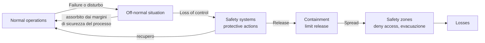

I layer, nell'ordine:

1. **Processo (process equipment) con margini di sicurezza.** In *normal operating conditions* il sistema è dentro il perimetro previsto dal progetto. Un guasto (failure) o un disturbo interno/esterno lo porta in **off-normal**. Grazie ai margini di progetto, il processo assorbe da solo i disturbi piccoli: passa un transitorio e torna normale senza interventi.
2. **Safety systems.** Se il disturbo supera la capacità di assorbimento si ha **perdita di controllo autonomo**. Intervengono tecnologie installate apposta, non usate nel funzionamento normale: shutdown automatico, sistemi aggiuntivi di rimozione del calore, ecc. Spesso sono attivati da sensori; a volte richiedono un operatore che, dato un allarme, li avvia dalla sala controllo secondo procedura.
3. **Containment.** Se anche i safety system non bastano si ha un **rilascio** (di energia, di sostanze tossiche). Il layer non è più preventivo ma **protettivo**: limita l'entità del rilascio.
4. **Safety zones.** Se il rilascio non è contenibile si protegge persone e ambiente dal rilascio: es. **evacuazione**, che è un layer puramente organizzativo (una procedura).

**Parallelo IT.** Anche le architetture IT seguono la stessa logica a strati (non a caso si parla di *firewall*); la slide la chiama anche *castle approach*: più livelli di controlli di sicurezza che coprono aspetti di personale, procedure, tecnologia e sicurezza fisica per tutto il ciclo di vita del sistema.

**AI agent.** Alcuni layer oggi possono essere automatizzati con agenti AI che leggono i sensori, fanno diagnosi e decidono. Il prof descrive due configurazioni studiate in un progetto europeo (air traffic management, protezione della rete elettrica dal blackout, gestione della rete ferroviaria):

- **handover**: il compito è diviso in sotto-compiti, alcuni eseguiti in autonomia dall'AI e altri dall'operatore;
- **parallel**: l'operatore fa tutto e prende tutte le decisioni, ma con supporto (informazioni migliori, pre-diagnosi) dall'AI.

I margini di sicurezza e il carico cognitivo nelle due configurazioni non sono uguali.

**Perché serve il defence-in-depth per capire gli HOF:** perché gli HOF agiscono proprio **alterando o creando vulnerabilità** in questa strategia a strati.

### 1.3 Il modello di Reason degli incidenti organizzativi (Swiss cheese)

Abbiamo dei **target** (asset tangibili o intangibili) esposti a pericoli fisici (hazard) o minacce cyber (threat). Li proteggiamo con difese a strati. Gli ingegneri le progettano per essere, nel loro insieme, affidabili. Nella realtà, comportamento umano, cognizione e dinamiche organizzative creano **buchi** nelle barriere. In certe circostanze i buchi **si allineano** e la minaccia attraversa tutti gli strati fino al target. I buchi non sono indipendenti: proprio a causa degli HOF sono **interdipendenti**, e questo apre la traiettoria dell'incidente. Da qui il nome *Swiss cheese model*.

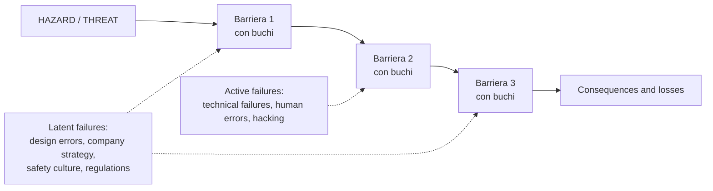

**Active failures (guasti/errori attivi).**

- Sono **sincroni nel tempo** con l'evento: la vulnerabilità nasce nello stesso momento in cui il pericolo la sfrutta.
- Comprendono gli *unsafe acts* direttamente collegabili all'incidente:
  - **guasti tecnici** (molto tipico: un componente si rompe e porta il sistema in off-normal);
  - **errori umani**: esecuzione, decisione, diagnosi, rilevazione (in cyber: *accidental insider*). Esempio del prof: una difesa non automatica deve essere attivata dall'operatore dopo un allarme; per disattenzione l'operatore non lo vede e la attiva troppo tardi;
  - **attacchi malevoli** fisici o cyber (*malicious insider*, hacker).

**Latent failures (errori latenti).**

- Sono vulnerabilità **nascoste**, presenti magari da molto tempo (giorni, settimane, mesi), che restano dormienti finché un pericolo non le sfrutta.
- Sono di natura soprattutto **organizzativa**: decisioni sbagliate in fase di **progettazione**; processi che garantiscono la disponibilità delle barriere durante la vita del sistema, come la **manutenzione** (anche delle barriere organizzative: es. le esercitazioni di evacuazione "manutengono" una procedura); strategia aziendale; **safety culture**; **regolamenti** in conflitto che creano vulnerabilità dipendenti tra layer diversi.
- Tipi (slide): *organizational influences, supervision, preconditions*. Evolvono nel tempo con i cambiamenti organizzativi, tecnologici e di contesto (in cyber spesso servono settimane o mesi per scoprire un breach).

**Triton come esempio.** Triton è un attacco cyber il cui scopo non è rubare dati né causare un disservizio, ma **creare buchi nelle difese fisiche** (i sistemi di sicurezza dell'impianto), rendendo il sistema vulnerabile a un pericolo fisico. È una minaccia **indiretta**: l'attacco è un active failure che apre la strada all'hazard.

### 1.4 HOF e gestione degli incidenti (error handling)

La slide "HOF and incident management" mostra il percorso del sistema da condizione normale a incidente maggiore, e dove intervengono gli HOF.

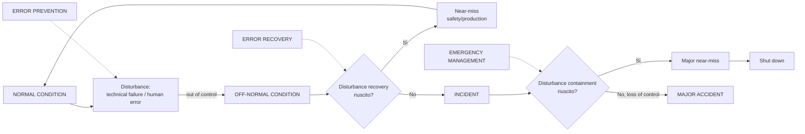

Tre fasi dell'**error handling**, tutte influenzate dal contesto (management e strategia):

1. **Error prevention**: evitare che errori e guasti generino il disturbo;
2. **Error recovery**: riportare il sistema alla normalità quando è in off-normal;
3. **Emergency management**: contenere l'evento quando è già un incidente.

**Perché l'automazione totale non è sempre meglio.** Anche se una tecnologia è più affidabile dell'uomo, se a un certo punto serve l'intervento umano (perché il pericolo ha reso inutilizzabili i mezzi tecnologici), gli operatori devono essere **"up to speed"**, cioè avere **situational awareness** (consapevolezza della situazione). Questa si costruisce solo se sono coinvolti fin dall'inizio e hanno il tempo di diagnosticare. Un'automazione spinta accelera e funziona meglio nell'80% dei casi, ma può creare situazioni in cui gli operatori, chiamati in causa all'improvviso, non hanno tempo per capire e decidere bene. È esattamente quello che succede nell'Evento 1 del nostro caso.

### 1.5 Che cos'è un errore umano

**Definizione (Reason, 1990):** errore è un termine generico che comprende tutte le occasioni in cui una sequenza pianificata di attività **mentali o fisiche** non raggiunge il risultato atteso, quando questi fallimenti **non possono essere attribuiti all'intervento del caso** (*chance agency*).

Punti chiave:

- **Mentale o fisica**: l'errore non è solo premere il pulsante sbagliato, ma anche il processo mentale che porta a premerlo, o una diagnosi sbagliata (le cui conseguenze possono vedersi ore o mesi dopo).
- **Chance agency**: se fallisci perché un pezzo di muro ti cade addosso, non è un errore, è il caso.
  - Azione riuscita: nessun errore. Azione fallita senza intervento del caso: **errore**. Azione fallita per intervento del caso: **non è un errore**.
- **L'errore è definito rispetto all'esito, non rispetto alla procedura.** Un'azione è un errore quando non è coerente con ciò che serve per mantenere il sistema sicuro nelle circostanze del momento. Una violazione di procedura è un errore solo se produce effetti non voluti. Le procedure **non sono la Bibbia**: possono essere sbagliate, e a volte applicarle correttamente contribuisce all'incidente. Se definissimo l'errore solo rispetto alla procedura perderemmo l'occasione di migliorare le procedure stesse.
- **Lo scopo non è trovare un colpevole.** L'errore umano è "l'ultimo miglio" di una lunga catena di meccanismi, come il guasto di un componente. A ingegneri e manager interessano i **fattori sottostanti**.

### 1.6 Classificazione di Swain e Guttman (1980): il fenotipo

È la classificazione più usata nelle analisi probabilistiche (Human Reliability Analysis) perché guarda solo ciò che è **osservabile**, cioè il **fenotipo** dell'errore.

| Tipo | Definizione | Esempio slide |
|---|---|---|
| **Error of omission** | l'operatore non esegue un'azione necessaria | errori di battitura (lettere mancanti) |
| **Error of commission** | l'azione è eseguita, ma in modo scorretto: azione diversa da quella giusta, oppure giusta ma eseguita male (**troppo tardi, troppo veloce, in ordine inverso**, ecc.) | martellarsi il pollice |
| **Violation** | l'operatore non segue una procedura ben nota. Può essere di natura omissiva o commissiva | passare col rosso |

Definizione di violazione (Maurino et al., 1995, in slide): deviazioni **deliberate, ma non necessariamente riprovevoli**, dalle pratiche ritenute necessarie (da ingegneri, manager e regolatori) per mantenere sicuro un sistema potenzialmente pericoloso. "Deliberata" non vuol dire "malevola": spesso si viola per ottenere un risultato (es. ripristinare il servizio).

Attenzione: "troppo tardi" è **commission** (azione eseguita ma male), non omission.

### 1.7 Tassonomia di Reason: mistake, lapse, slip (il genotipo cognitivo)

Qui non si guarda il fenotipo ma **lo stadio del processo cognitivo in cui nasce l'errore**. Modello semplicissimo in tre stadi: (1) fissare l'**intenzione** (cosa devo fare?), (2) recuperare dalla **memoria** conoscenze e informazioni per tradurre l'intenzione in azione, (3) **eseguire**.

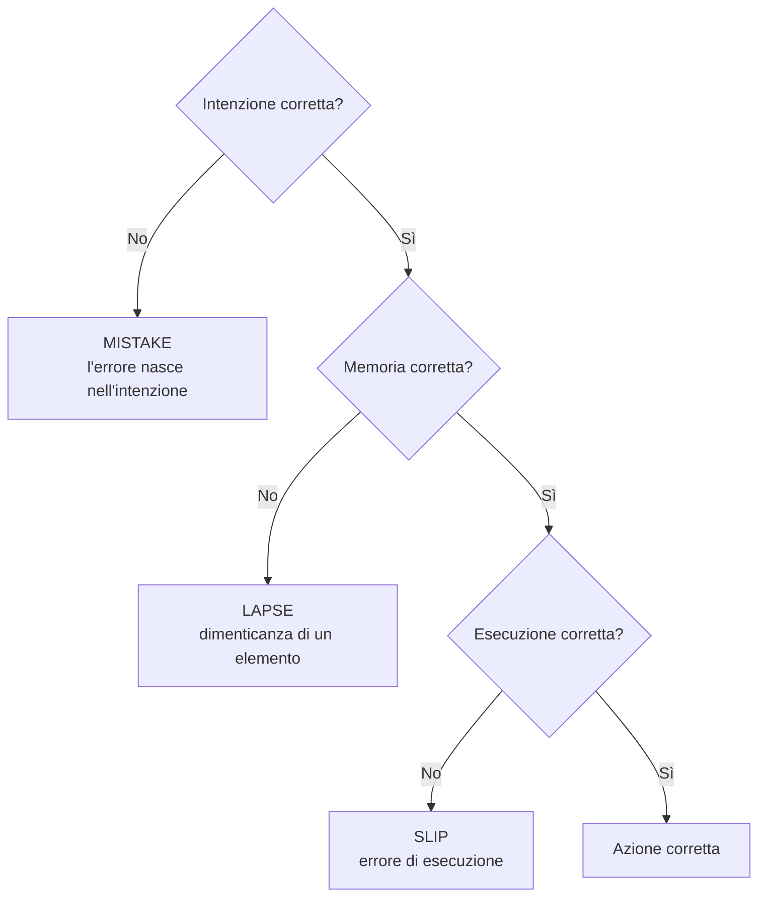

- **Mistake**: l'operatore individua fin dall'inizio un'azione/decisione sbagliata. "Intenzione" **non** significa "di proposito": significa che l'errore è radicato nella fase in cui l'operatore cerca di capire cosa deve fare (diagnosi, valutazione, scelta).
- **Lapse**: l'intenzione era giusta, ma si dimentica qualcosa (es. un passo della procedura).
- **Slip**: intenzione e memoria giuste, l'errore avviene nell'esecuzione (es. non notare qualcosa, premere il tasto vicino).

Nel quadro più ampio di Reason, tra gli *unsafe acts* ci sono anche le **violazioni** (deviazioni deliberate), che la slide 14 non disegna ma che troviamo in Swain e Guttman. Nel minor usiamo l'etichetta *Violation* per l'Evento 7.

### 1.8 Il modello step-ladder / SRK di Rasmussen (1986)

Il modello guarda la cognizione come una macchina di elaborazione delle informazioni. Nel disegno originale è una "scala": si sale a sinistra (capire) e si scende a destra (agire).

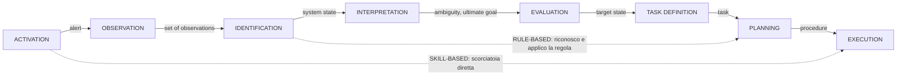

Gli stadi, con gli esempi del prof (l'allarme in sala controllo, il semaforo):

| Stadio | Domanda |
|---|---|
| Activation | uno stimolo attira l'attenzione (allarme) |
| Observation | quali dati raccolgo? |
| Identification | su cosa mi concentro? (la luce rossa, non le altre) |
| Interpretation | cosa significa? ("la temperatura in quella sezione è molto più alta del normale") |
| Evaluation | è pericoloso? mi deve preoccupare? |
| Task definition | devo fare qualcosa? cosa ci si aspetta da me? |
| Planning | come lo faccio? quali informazioni e conoscenze mi servono? |
| Execution | eseguo |

**Tre livelli di comportamento (e tre tipi di errore):**

- **Skill-based**: scorciatoia da attivazione a esecuzione. Azioni automatiche, come molte azioni di guida (cambiare marcia). Situazioni **di routine**, controllo **automatico**.
- **Rule-based**: dallo stimolo si richiama una regola e si agisce (vedo il rosso, ricordo la regola, freno). Situazioni **per cui si è addestrati**, controllo **misto**. È l'area delle **procedure**.
- **Knowledge-based**: situazioni nuove e complesse che richiedono tutto il processo cognitivo (diagnosi completa). Problemi **nuovi**, controllo **cosciente**.

**Legame con il task design e il training** (punto chiave per il minor): il tipo di errore indica direttamente la leva di miglioramento.

| Situazione | Livello desiderato | Leva di progetto |
|---|---|---|
| Routine, frequente | skill-based | addestramento che crea automatismi, interfaccia chiara |
| Problemi previsti | rule-based | **procedure** e addestramento sulle procedure |
| Problemi nuovi e rari | knowledge-based | **conoscenza** profonda del processo (es. termoidraulica) per diagnosticare |

**Fenotipo vs genotipo.** Il **fenotipo** è come l'errore si manifesta (cosa si vede: omissione, commissione). Il **genotipo** è la causa cognitiva o di contesto che lo ha generato (mistake/lapse/slip, livello S/R/K, condizioni di lavoro, fattori latenti). Swain e Guttman classificano il fenotipo; Reason (mistake/lapse/slip) e Rasmussen (SRK) vanno verso il genotipo.

### 1.9 Approcci di analisi HOF

| | **Behavioural analysis** (macroscopica) | **Cognitive analysis** (microscopica) |
|---|---|---|
| Focus | azioni dell'operatore (fenotipo, *error mode*) e loro conseguenze | anche i processi cognitivi e gli errori "di alto livello" (genotipo): percezione, rilevazione, interpretazione |
| Modello cognitivo | non serve | si sceglie un modello di cognizione e si collegano azione e fattori fisici, organizzativi, psicologici **attraverso** la cognizione |
| Metodi | Human HAZOP, THERP, **Tripod**, ... | ATHEANA, MERMOS, **CREAM**, PROCOS, ... |
| Nel caso | **template di Reason** | **schema CREAM** (Fig. 5 del caso) |

Nei sistemi complessi le due analisi sono **integrate**: l'analisi cognitiva è uno "zoom" dentro il box *Active errors* del template di Reason (slide 21).

**Retrospettivo vs prospettico.** Si possono usare retrospettivamente (indagare un evento accaduto per imparare) o prospetticamente (supportare il progetto di sistema e procedure in modo anticipatorio). Sono complementari.

**Near miss.** È una situazione reale in cui si osserva il meccanismo di un incidente ma, per fortuna, senza conseguenze gravi. Il rapporto tra near miss e incidenti gravi con lo stesso meccanismo è abbastanza stabile tra settori: nel **petrolchimico circa 20 a 1**. I near miss sono un "regalo": un'occasione di imparare senza danni. Il confine tra near miss e *minor incident* dipende dal settore e dall'azienda: conta applicare una classificazione in modo coerente e spremerne lezioni.

### 1.10 Il template di Reason (behavioural approach) box per box

Questo è lo schema da compilare nel minor (Fig. 4 del caso, slide 19 della lezione 7).

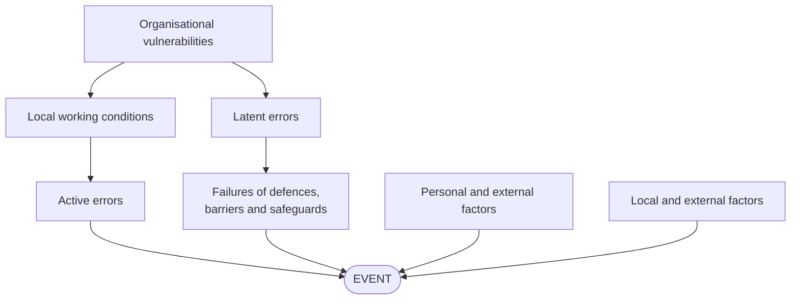

A sinistra il **human error path** (nelle soluzioni del prof: *Human factors pathway*), a destra il **system failure path** (*System factors pathway*).

**Logica di lettura (dal prof).** Si parte dall'**evento** e si chiede: è avvenuto perché c'è stato **almeno uno** tra (a) un **guasto tecnico di una difesa, barriera o salvaguardia** e (b) un **errore attivo** umano? Non per forza entrambi. Poi si cercano le condizioni locali/esterne che hanno favorito guasto o errore, poi si risale alle cause latenti. In pratica si parte dal **fenotipo** (come si manifesta l'evento) e si risale ai **genotipi** (cause latenti e di contesto).

| Box | Cosa ci va | Domanda guida | Esempio dal caso |
|---|---|---|---|
| **Event** | il sotto-evento della timeline (non l'intero incidente), con l'ora | cosa è successo, quando? | "Start of a transient de-pressurisation (02.00 h)" |
| **Active error** | l'errore umano sincrono con l'evento, classificato (mistake/slip/lapse/violation) | quale azione o decisione umana sbagliata (o mancata) ha prodotto o non ha fermato l'evento? | "Operators did not understand DCS automatic routine (Mistake)" |
| **Local working conditions** | condizioni del posto di lavoro che hanno reso possibile l'errore: interfaccia (HMI), allarmi, procedure, carico di lavoro, organizzazione del turno | perché l'operatore ha sbagliato proprio lì? | HMI a finestre stratificate, mancanza di procedure |
| **Personal and external factors** (lato umano) | stato della persona (attenzione, fatica, stress, conoscenze) e fattori esterni che pesano sulla persona (turno di notte, bassa produzione) | in che stato era l'operatore e cosa lo influenzava dall'esterno? | basso livello di attenzione; turno di notte |
| **Failure in defence** | il guasto tecnico della barriera/salvaguardia | quale difesa tecnica ha fallito o mancava? | guasto del trasduttore di pressione |
| **Latent error** (lato sistema) | errori di progetto o manutenzione **della parte tecnica** che hanno reso possibile quel guasto | perché quella difesa era vulnerabile? | sensore installato all'esterno, nessuna ridondanza |
| **Local and external factors** (lato sistema) | condizioni ambientali o di processo che hanno innescato o accelerato il guasto | cosa c'era intorno alla difesa? | temperatura esterna -5 °C |
| **Organisational vulnerabilities** (box in alto; nelle soluzioni del prof si chiama ancora *Latent error*) | cause latenti che influenzano **entrambi** i percorsi | quale decisione organizzativa o di progetto sta dietro sia al lato umano sia al lato tecnico? | errore di progetto del sistema di controllo |

**Regola del prof: "scope of influence" (alto o laterale?).**

- Se un fattore influenza **un solo percorso** (solo le condizioni di lavoro/errore umano, oppure solo il guasto tecnico), va nel rispettivo box **Latent error laterale** (sinistra: in pratica ricade nelle *local working conditions* e nei latenti lato umano; destra: *Latent error* tecnico).
- Se influenza **entrambi i percorsi** va **in alto**, nelle *Organisational vulnerabilities*.
- Esempio del prof (Evento 3): la decisione congiunta, tecnica e organizzativa, di come dimensionare il sistema di scarico rispetto a procedure e tempi di intervento degli operatori pesa su entrambi i lati, quindi va in alto.

**Convenzione dei colori (nostra inferenza).** Nelle due slide di soluzione alcuni box sono rossi e altri bianchi. Il prof non l'ha spiegato esplicitamente; leggendo le due slide ricaviamo questa regola, che applichiamo in modo coerente in tutto il minor:

- **rosso** = box sulla **catena causale diretta** dell'evento: l'errore attivo e/o il guasto della difesa che producono l'evento, più il latent error tecnico subito dietro il guasto;
- **bianco** = condizioni contributive (local working conditions, box in alto, fattori personali ed esterni).

Verifica sulle slide: nell'**Evento 1** sono rossi solo i box del lato sistema, perché la depressurizzazione l'ha causata il guasto del sensore, mentre il mistake degli operatori (non capire la routine del DCS) non l'ha causata ma ha solo mancato l'occasione di fermarne gli sviluppi. Nell'**Evento 3** è rosso anche l'errore attivo, perché l'omessa chiusura delle valvole e il mancato riconoscimento dell'allarme hanno contribuito direttamente all'allagamento. In entrambe le slide le *local working conditions* e il box in alto restano bianchi.

### 1.11 CREAM (Hollnagel, 1998): l'analisi cognitiva

CREAM (Cognitive Reliability and Error Analysis Method) è il metodo cognitivo proposto dal caso (Fig. 5) e richiamato dal prof nella discussione finale come prospettiva "microscopica" su E1 ed E3 (il prof ha detto che avrebbe fornito questa analisi nei file di soluzione).

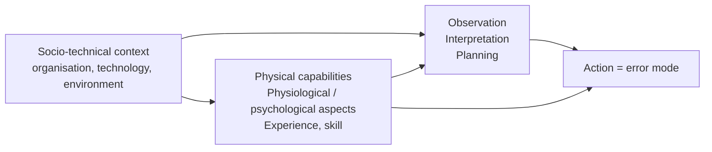

Lettura dello schema:

- il **contesto socio-tecnico** (organizzazione, tecnologia, ambiente) influenza sia le **funzioni cognitive** (osservazione, interpretazione, pianificazione) sia i **fattori individuali** (capacità fisiche, aspetti fisiologici o psicologici, esperienza e abilità; la Fig. 5 del caso scrive *physiological*, la slide 12 *psychological*);
- dalla combinazione nasce l'**azione**, che se errata si descrive con un **error mode**;
- la tassonomia CREAM serve da due lati: gli **antecedenti** (perché) collegano errore e contesto/cognizione; lo **specific effect** descrive la forma dell'errore.

**Come si legge la tabella dell'annex.**

- **General effect**: la dimensione dell'azione che è andata male (tempo, durata, sequenza, forza, distanza, velocità, direzione, oggetto).
- **Specific effect**: la forma precisa (troppo presto, troppo tardi, omissione, ecc.). È l'**error mode** (fenotipo).
- **General antecedent**: la causa generale tipica di quell'error mode (diagnosi sbagliata, osservazione mancata, procedura inadeguata, ecc.).
- **Specific antecedent**: una causa più specifica, se applicabile (omissione precedente, etichetta ambigua, ecc.).

| General effects | Specific effects | General antecedent | Specific antecedent |
|---|---|---|---|
| **Timing** | Too early, Too late, Omission | Communication failure, Faulty diagnosis, Inadequate plan, Inadequate procedure, Inattention, Observation missed | Earlier omission, Trapping error |
| **Duration** | Too long, Too short | (come Timing) | (come Timing) |
| **Sequence** | Omission, Jump forward, Jump backwards, Repetition, Reversal, Wrong action | Access limitations, Communication failure, Faulty diagnosis, Inadequate plan, Inadequate procedure, Inattention, Memory failure, Wrong identification | Trapping error |
| **Force** | Too little, Too much | Communication failure, Equipment failure, Faulty diagnosis, Inadequate plan, Inadequate procedure, Observation missed | Ambiguous label, Convention conflict, Incorrect label |
| **Distance / magnitude** | Too far, Too short | Communication failure, Equipment failure, Faulty diagnosis, Inadequate plan, Inadequate procedure, Observation missed | Ambiguous label, Convention conflict, Incorrect label |
| **Speed** | Too fast, Too slow | Communication failure, Distraction, Equipment failure, Faulty diagnosis, Inadequate plan, Inadequate procedure, Observation missed, Performance variability | None defined |
| **Direction** | Wrong direction, Wrong movement type | Communication failure, Faulty diagnosis, Inadequate plan, Inadequate procedure, Inattention, Observation missed | Ambiguous label, Convention conflict, Incorrect label |
| **Wrong object** | Neighbour, Similar object, Unrelated object | Access problems, Communication failure, Wrong identification, Inadequate plan, Inadequate procedure, Inattention, Performance variability, Observation missed | Ambiguous label, Incorrect label |

**Come usarla sui nostri eventi (procedura in 5 passi):**

1. prendi l'azione errata dal box *Active error* del template di Reason;
2. scegli general effect e specific effect (es. Timing, Too late);
3. scegli uno o più general antecedent coerenti con il testo (es. Faulty diagnosis perché non avevano capito la situazione);
4. scegli lo specific antecedent solo se ha senso (es. *Earlier omission*: la diagnosi mancata in un evento precedente);
5. collega a funzione cognitiva (osservazione, interpretazione, pianificazione), fattori individuali e contesto.

Nota: *Trapping error* compare nella tabella ma il suo significato non è spiegato nel materiale del corso; per prudenza nel minor non lo usiamo.

### 1.12 TRIPOD Beta (da sapere, non serve per il minor)

Logica: gli eventi sono causati da controlli e/o barriere che falliscono a causa di **active failures**, **preconditions** e **latent failures**.

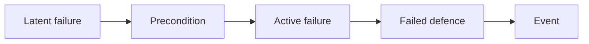

- **Barrier**: qualsiasi difesa (procedura, hardware, sistema) che protegge persone, ambiente, asset, reputazione.
- **Active failure**: causa immediata, atto non sicuro o "cosa" che rompe una barriera.
- **Precondition**: ciò che favorisce o permette l'active failure.
- **Latent failure**: la root cause (di solito un errore manageriale o organizzativo).
- **Event trio**: un **hazard** colpisce un **target** e genera un **evento**; hazard o target possono essere a loro volta il risultato di un evento precedente.
- **Basic Risk Factors (BRF)**: Design, Hardware, Maintenance, Housekeeping, Error enforcing conditions, Procedures, Training, Communication, Incompatible goals, Organisation, Defences.

Corrispondenza utile con il template di Reason (nostra lettura): latent failure circa *organisational vulnerabilities / latent error*, precondition circa *local working conditions*, active failure circa *active error*, failed defence circa *failure in defence*. I BRF sono una buona lista di controllo per non dimenticare categorie di cause (es. *Incompatible goals* è il conflitto "ripristino del servizio vs stato sicuro" del nostro caso).

---

## 2. Il caso

### 2.1 L'impianto

Impianto di **cogenerazione** (produce insieme elettricità e calore) che fornisce elettricità e acqua calda pressurizzata per il teleriscaldamento di una popolazione di **diverse centinaia di migliaia** di persone in un'area urbana (una grande città italiana, secondo il prof).

| Componente | Dati |
|---|---|
| Gruppo di generazione **GT-2** | 136 MW elettrici, 162 MW termici, metano o olio |
| Gruppo **turbo-gas** | 35 MW elettrici nominali, 63 MW termici dai gas di scarico, metano o gasolio |
| **Centrale termica** di integrazione e riserva | 141 MW termici con 3 generatori di vapore da 47 MW, metano o olio |
| **Centrale idroelettrica** | 4,5 MW |
| Rete di distribuzione | doppia tubazione (mandata e ritorno), 3 stazioni di pompaggio principali, scambiatori di calore presso le utenze principali |
| Fluido | acqua pressurizzata: max **120 °C** in mandata, **60-70 °C** in ritorno (in casi speciali 100 °C), pressione circa **0,95 MPa** |
| Estensione | **12 km²**, volume degli edifici riscaldati circa **22,5 x 10⁶ m³** |

**Come funziona (spiegazione del prof).** La centrale termoelettrica produce elettricità con turbine a gas e a vapore. A fine ciclo resta calore residuo da rimuovere con uno scambiatore a bassa pressione, il **condensatore** (il vapore uscito dalla turbina condensa tornando liquido). In cogenerazione questo calore viene usato per il teleriscaldamento. La rete cittadina non è collegata direttamente alla centrale: c'è un **circuito chiuso intermedio** (una grande tubazione principale) tra condensatore e scambiatori della rete. L'incidente avviene proprio in questo circuito.

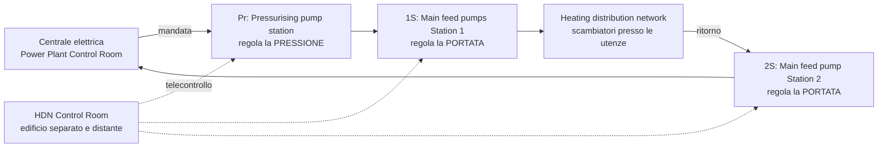

Punti chiave per capire gli errori:

- **Due sale controllo fisicamente separate e distanti**: quella della rete (HDN) e quella della centrale (Power Plant).
- **Portata e pressione sono controllate in modo disaccoppiato**: due stazioni regolano la portata (1S in mandata, 2S in ritorno), una la pressione (Pr).
- **Per seguire la domanda di calore si regola la portata, non la pressione** (che per progetto deve restare il più costante possibile). Più domanda, più portata. La regolazione è quasi tutta automatica.
- Quindi gli operatori sono **abituati a vedere la portata cambiare di continuo** e devono solo controllare che la pressione resti costante. Questa abitudine spiega perché, nell'emergenza, si sono concentrati sulle pompe di circolazione (portata) ignorando altre informazioni.

### 2.2 Controllo e regolazione (sezione 1.2-1.3 del caso)

**Working modes** della centrale: non disponibile, standby, pronta a operare, in operazione.

**Modi di controllo** di centrale e stazioni di pompaggio:

| Modo | Descrizione |
|---|---|
| **Manual** | operazioni locali su valvole motorizzate, regolazioni e pompe. È un sistema di **emergenza e backup**, da usare **raramente** perché complesso e difficile |
| **Automatic-local** | l'operatore imposta localmente i set point (energia termica per ogni caldaia, portata di bypass per ogni generatore, temperatura di uscita dell'acqua) e poi il sistema lavora in automatico |
| **Automatic-remote** | il più avanzato: gestione dell'intero processo dalla sala controllo |

**Ambiente di lavoro e telecontrollo:**

- il gruppo (produzione termica ed elettrica) è controllato da una sala nello stesso edificio, con strumenti **sinottici** e alcune funzioni elettroniche;
- alcune funzioni del turbo-gas sono controllate da lì, le altre da una sala controllo **normalmente non presidiata**;
- la rete di distribuzione è gestita con **VDU** (video display unit) in un'altra sala, in un **edificio diverso**, tramite il **sistema centrale di telecontrollo elettronico**; in questa sala ci sono anche i pannelli dei 3 generatori di vapore della centrale termica.

Il **central electronic tele-operating system** serve a: selezionare e distribuire il carico termico tra i gruppi; telecontrollare stazioni di pompaggio, sistemi di backup e pressurizzazione, valvole di regolazione, stazioni locali di scambio termico e perdite di pressione.

Nella stessa sala: 2 VDU per la rete; un PC per configurare il controllo di processo; **due sistemi ridondanti "Series 9000"** per acquisizione dati e gestione dei sottosistemi; 2 stampanti per dati e allarmi; l'**ODS** (optical data system) che converte i segnali via fibra ottica tra sistema centrale e Series 9000. I Series 9000 sono i nodi primari: collegano i sottosistemi al sistema centrale e permettono il **controllo locale** di ogni sottosistema se il sistema centrale si guasta; queste operazioni di emergenza vanno fatte **in locale**, da pannelli specifici.

**Protezioni rilevanti (sezione 2):**

- il **sistema di pressurizzazione** mantiene in tutta la rete una pressione statica di 0,95 MPa, per evitare che in qualche punto si raggiunga la pressione di vapore corrispondente alla temperatura di progetto (cioè per evitare l'ebollizione);
- un **trasduttore di pressione installato all'esterno** dell'edificio principale, vicino a un vaso di espansione, regola i giri delle pompe e invia dati alle valvole di controllo della pressione;
- **due vasi di espansione** come protezione ulteriore;
- un **sistema antincendio** che in caso di incendio **taglia tutta l'alimentazione elettrica**; un sistema di backup fornisce solo la potenza minima per **mantenere i set point del controllo automatico**.

### 2.3 La fisica del colpo d'ariete (water hammer), spiegata semplice

- In condizioni normali nel tubo c'è **solo acqua liquida ad alta pressione**. La pressione alta permette all'acqua di stare sopra i 100 °C senza bollire, e quindi di trasportare più calore.
- Il problema nasce quando nel tubo si forma un **fluido bifase** (acqua + vapore). Succede in due modi: vapore che condensa in parte, oppure **depressurizzazione** di acqua calda ad alta pressione. È come aprire la valvola di una pentola a pressione: la pressione cala e l'acqua surriscaldata bolle all'istante.
- Con acqua e vapore insieme, il flusso forma onde che **intrappolano sacche di vapore** tra una cresta d'acqua e l'altra.
- Se a quel punto si **ripressurizza** di colpo (es. riaccendendo le pompe), le sacche di vapore **collassano istantaneamente** (il liquido è molto più denso del vapore). L'acqua che si richiude genera un'**onda d'urto** ad altissima pressione che corre lungo il tubo.

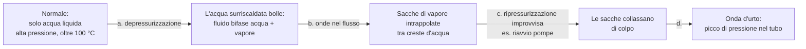

L'energia è enorme: può distruggere le pale delle pompe e danneggiare gli scambiatori. Nel caso (dati del testo, sezione 2, evento 9): un punto di ancoraggio della tubazione principale si è **spostato di 90 mm** restando deformato in modo permanente; forza stimata **35-45 tonnellate**, picco istantaneo di **3-4 MPa**; l'onda ha raggiunto gli **scambiatori** danneggiandone i componenti interni.

> Attenzione a una discrepanza: nel riassunto della videolezione si legge che la tubazione si sarebbe spostata di "quasi un metro". Il testo scritto del caso dice **90 mm**. Nel minor usiamo il dato del testo.

**Il "messaggio cognitivo" della fisica.** Per l'analisi HOF il punto non è la termodinamica in sé: è capire che gli operatori potevano evitare il colpo d'ariete solo se sapevano che **depressurizzare e poi ripressurizzare bruscamente una rete calda è pericoloso**. Senza conoscenze termoidrauliche (sezione 3.1 del caso) non potevano prevederlo: è un tipico problema da livello **knowledge-based**.

### 2.4 Timeline degli eventi

L'incidente è avvenuto nel **febbraio 2009**, di notte. Evento iniziatore: guasto del trasduttore di pressione.

| # | Ora | Cosa succede (testo del caso) | Fase (slide "Causal and contributing factors") |
|---|---|---|---|
| 1 | 02.00 | Il trasduttore di pressione si guasta per il freddo (molto basso ma non eccezionale; il prof dice -5 °C), gelano anche i tubi di trasmissione del segnale. Indica falsamente **1,76 MPa** mentre la pressione reale è normale. Il controllo automatico reagisce: riduce i giri delle pompe di pressurizzazione, apre le valvole di sfogo e quelle dei vasi di espansione, ferma le pompe di alimentazione principali. Parte una **rapida depressurizzazione** | 1a depressurizzazione e vaporizzazione, gestione dalla sala controllo |
| 2 | 02.04 | Benché la pressione sia bassa, le pompe di ricircolo principali vengono **avviate manualmente dalla sala controllo**, a giri minimi. Aumenta la vaporizzazione | 1a fase, sala controllo |
| 3 | 02.41 | Il serbatoio di raccolta raggiunge il livello massimo, l'acqua esce dalle valvole di sfogo; il sistema di emergenza è sottodimensionato e l'**acqua bollente allaga la sala pompe** | 2a fase, gestione sul campo |
| 4 | 03.00 | **Chiusura manuale delle valvole di sfogo** (vasi di espansione) e **bypass dello scambiatore**: azioni di protezione essenziali, fatte con **grande ritardo** | contribuisce a più fasi (sala controllo, campo, scambio termico) |
| 5 | 03.20 | Allagamento e vapore fanno intervenire l'**antincendio**, che non distingue vapore da fumo: **taglio totale dell'alimentazione**, pompe ferme, **telecontrollo fuori servizio** | 2a fase, gestione sul campo; alimenta anche le fasi successive |
| 6 | 03.45 | Ulteriore **aumento della temperatura** dell'acqua (in uscita dagli scambiatori) per fuoriuscita e miscelazione dell'acqua nel sistema | vaporizzazione dovuta allo scambio termico |
| 7 | 04.39 | **Avvio manuale delle pompe di ricircolo bypassando la protezione di bassa pressione** (dopo tre tentativi falliti): ulteriore calo di pressione seguito da una **violenta pressurizzazione** | picco di pressurizzazione |
| 8 | 05.15 | **Avvio manuale del recupero termico dal turbo-gas** | vaporizzazione dovuta allo scambio termico |
| 9 | 06.15 | **Onda d'urto** (colpo d'ariete) | evento finale, convergono tutte le fasi |

Ritardi utili per le giustificazioni: dall'apertura delle valvole (02.00) alla loro chiusura (03.00) passa **circa un'ora**; dall'overflow (02.41) alla chiusura circa **20 minuti**.

### 2.5 Fattori causali e contributivi (slide 5)

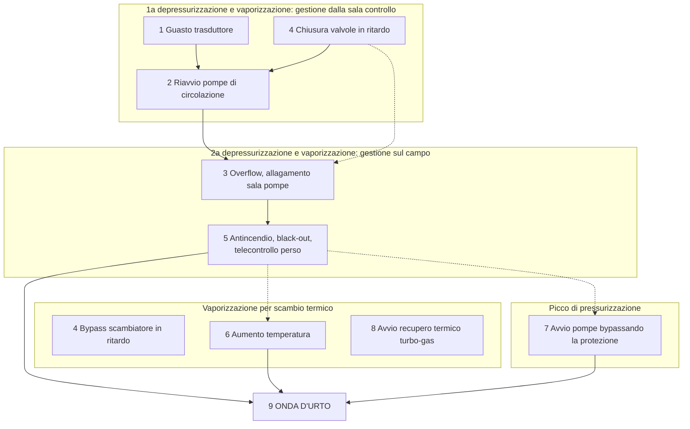

Lettura del prof:

- prima l'emergenza è gestita **dalla sala controllo** (eventi 1, 2, 4), poi **"sul campo"** (eventi 3, 5, 6, 7, 8);
- **perché sul campo?** L'acqua bollente ha allagato la sala pompe, il vapore ha fatto scattare l'antincendio che ha **tagliato la corrente anche al telecontrollo**: da quel momento gli operatori erano "ciechi" e senza comandi remoti, e sono dovuti entrare nella sala pompe allagata (con circa un metro e mezzo di acqua bollente, secondo il prof) per azionare le pompe a mano;
- **seconda vaporizzazione (eventi 6 e 8)**: gli operatori della centrale hanno riavviato il recupero termico immettendo altro calore in un tubo già a bassa pressione e pieno di vapore; quando poi le pompe sono state riavviate bypassando la protezione di bassa pressione (evento 7) si è innescato il colpo d'ariete (evento 9).

L'evento 4 compare in più gruppi della slide perché contiene due azioni (chiusura delle valvole di sfogo e bypass dello scambiatore) che pesano su fasi diverse.

### 2.6 Il contesto organizzativo (sezione 3 del caso) e dove va nel template

Questa tabella è il "magazzino" da cui pescare per compilare i box. La colonna centrale indica la collocazione tipica (dipende comunque dall'evento e dalla regola dello *scope of influence*).

| § | Fattore (testo del caso) | Box tipico del template | Eventi in cui pesa di più |
|---|---|---|---|
| 3.1 | Squadra di supervisione per turno **insufficiente** per un'emergenza | Local working conditions (o in alto se lo si lega anche a scelte di progetto) | 4, 5, 9 |
| 3.1 | Primo obiettivo operativo dichiarato: **garantire il riscaldamento** agli utenti | Organisational vulnerabilities (influenza priorità degli operatori e scelte di progetto) | 2, 7, 8, 9 |
| 3.1 | Operatori **senza conoscenze termoidrauliche** per prevedere un'onda d'urto | Personal factors | 4, 6, 7, 8, 9 |
| 3.1 | **Mancanza di controllo centralizzato**: due sale controllo, possibili incomprensioni e decisioni incoerenti | Organisational vulnerabilities | 4, 6, 8, 9 |
| 3.2 | Il supervisore doveva **spostarsi tra le due sale**, non vicine | Local working conditions | 4, 6, 8 |
| 3.3 | Nessun allarme di **"abnormal measure"** (valore fuori dal range del trasduttore) | Latent error (sistema) o Local working conditions | 1, 4 |
| 3.3 | Monitoraggio della rete elettrica (anche dei riscaldatori dei trasduttori esterni) **progettato male**: impossibile rilevare il guasto elettrico | Latent error (sistema) / box in alto | 1 |
| 3.3 | Allarme "**alto livello nel serbatoio**" perso in una lunga lista di allarmi; HMI a **finestre stratificate** senza visione d'insieme | Local working conditions (latent: progetto del sistema di allarme) | 1, 2, 3, 4 |
| 3.3 | Nessuna **videosorveglianza** delle stanze | Local working conditions | 5 |
| 3.4 | **Nessuna procedura** di emergenza | Local working conditions | tutti |
| 3.4 | **Obiettivi in conflitto**: "ripristinare il servizio" vs "raggiungere le condizioni nominali sicure" | Local working conditions / Organisational vulnerabilities | 2, 7, 8 |
| 3.5 | **Tempo disponibile** molto limitato in emergenza | External factors (lato umano) | 4, 5, 7 |
| 3.6 | **Turno di notte** | External factors (lato umano) | tutti |
| 3.7 | Formazione solo **"on the job"**, senza aggiornamento periodico; esperienza inadeguata per le emergenze | Local working conditions / Personal factors / Organisational vulnerabilities | 1, 4, 7 |
| 3.8 | Team e collaborazione: **nessuna informazione** | non usare (non inventare) | - |
| 1.2 | Modo **manuale** complesso, rarissimo, solo per emergenza | Local working conditions | 7 |
| 1.3 | Funzioni del turbo-gas in parte controllate da una sala **non presidiata** | Latent error (sistema) | 8 |
| 2 | Backup elettrico che mantiene **solo i set point** del controllo automatico | Latent error (sistema) | 5, 6 |

### 2.7 Il legame con la cybersecurity

Perché studiare questo caso in un corso di cyber risk? Perché mostra come operatori e processo possano essere **ingannati da informazioni incoerenti**. Qui tutto parte dal guasto di un sensore che manda un falso segnale di alta pressione. Lo stesso identico scenario potrebbe essere causato oggi da un **attaccante** che entra nel sistema IT/OT e altera l'**integrità** del dato del sensore (la "I" della triade **CIA**: Confidentiality, Integrity, Availability), magari con sale controllo remote a 100 km.

Lezioni:

- non basta proteggere il lato digitale: serve **resilienza operativa** anche sul lato fisico, cioè la capacità di riconoscere e gestire informazioni alterate o non disponibili (prevenzione, assorbimento, risposta, ripristino);
- difese contro la perdita di integrità o disponibilità di un dato critico: **ridondanza** (più sensori, fonti alternative) e **triangolazione dei dati** (verificare un dato confrontandolo con grandezze fisicamente correlate: qui una pressione di 1,76 MPa era incompatibile con temperatura e portata del momento);
- l'allineamento tra **safety engineering** e **IT security** non va fatto solo in progettazione ma mantenuto per **tutto il ciclo di vita operativo** del sistema.

### 2.8 Cosa è successo dopo l'incidente (dal prof)

**Interventi:**

1. riprogettazione e ristrutturazione delle **stazioni di pompaggio**; **ricollocazione e ridondanza dei sensori**; sostituzione quasi totale del **DCS**;
2. sala controllo riprogettata: sala della rete (HDN) e sala della centrale **unite nello stesso edificio e nella stessa stanza** (aree di lavoro distinte ma comunicazione immediata);
3. **programma di 5 anni** per riprogettare tutte le procedure e riaddestrare tutti gli operatori.

**Conseguenze:**

- **nessuna responsabilità legale verso l'esterno**: niente feriti, morti, contaminazione o danni a terzi;
- **penali contrattuali basse** per il disservizio, perché di notte la domanda di calore è minima (di giorno sarebbero state molto più alte);
- **danno interno enorme**: oltre alla tubazione, il condensatore della centrale è stato sostituito **5 anni prima** della fine della vita utile (circa **-30%** di vita utile su un asset da circa **15 milioni di euro** all'epoca).

---

## 3. Come ha ragionato il prof sugli eventi 1 e 3

Il prof applica il template non all'intero incidente ma a **singoli sotto-eventi** della timeline. Parte dal fenotipo (come si manifesta l'evento) e risale ai genotipi.

### 3.1 Evento 1: "Start of a transient de-pressurisation" (02.00 h)

Schema della slide di soluzione (contenuti identici alla slide):

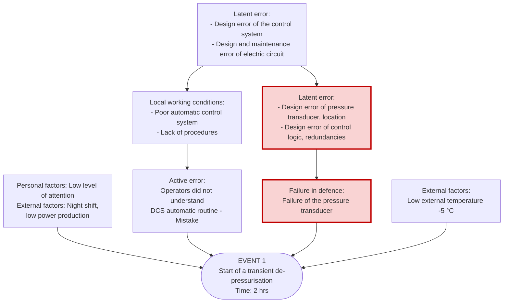

**Lato sistema (destra).**

- **Failure in defence: guasto del trasduttore di pressione.** Il sensore era all'aperto, dotato di un circuito elettrico di riscaldamento antigelo. La *root cause* tecnica è il **guasto di quel circuito di riscaldamento**: con -5 °C il sensore è gelato e ha mandato un falso segnale di 1,76 MPa.
- **External factors: bassa temperatura esterna (-5 °C).**
- **Latent error tecnico.** La pressione è un'informazione critica per la sicurezza: metterne la fonte all'esterno, esposta alle intemperie, è un **errore di progetto sulla localizzazione** (anche se c'era il riscaldatore). E come ci si protegge dalla perdita di integrità o disponibilità di un dato così critico? Con **ridondanze** (più sensori, qui assenti) e con la **triangolazione dei dati** (pressione confrontata con temperatura e portata: 1,76 MPa era termodinamicamente incompatibile). Il controllo non faceva questo controllo incrociato.
- Ricorda il defence-in-depth: la prima barriera è la capacità del **DCS** (Distributed Control System) di autoregolarsi. Ricevuta la falsa sovrapressione, il DCS ha avviato **come misura di sicurezza** un transitorio di depressurizzazione. La difesa ha funzionato "bene" su un dato sbagliato.

**Lato umano (sinistra).**

- **Active error: gli operatori non hanno capito cosa stava facendo la routine automatica del DCS (Mistake).** Non si può pretendere che un operatore blocchi all'istante un ciclo automatico (se automatizzi una routine, ti fidi della sua logica). L'errore è cognitivo: hanno **perso l'occasione di costruire situational awareness** fin dall'inizio.
  - *Come lo sappiamo?* Dal **fenotipo dell'evento successivo** (Evento 2): la prima cosa che hanno fatto è stata riavviare a mano le pompe di circolazione (due volte, secondo il prof) mentre le valvole di sfogo erano aperte, pompando fuori acqua. Lo hanno fatto perché la loro priorità era **evitare il disservizio**, e il riscaldamento si regola con la portata: viste le pompe ferme, le hanno riaccese d'impulso senza chiedersi **perché** si fossero fermate.
- **Local working conditions:**
  - *poor automatic control system (HMI)*: nessun sinottico unico, tante pagine separate; impossibile vedere tutti gli allarmi in un colpo d'occhio;
  - *lack of procedures*: nessuna procedura scritta e nessun addestramento mirato sul transitorio di depressurizzazione.
- **Latent error in alto:** *design error of the control system* e *design and maintenance error of electric circuit*. Il prof sottolinea che la **manutenzione di una barriera non è solo tecnica**: non aver dato procedure e addestramento significa non aver "manutenuto" la difesa costituita dalla situational awareness degli operatori. Per questo il fattore sta in alto (pesa su entrambi i lati).
- **Personal ed external factors (lato umano):**
  - *external*: **turno di notte e bassa produzione**. Di notte la domanda è al minimo (*base load*) e stabilissima: l'interazione operatore-sistema è quasi nulla, mentre di giorno i picchi di domanda tengono alta e aggiornata la situational awareness;
  - *personal*: **basso livello di attenzione**. In un turno di notte in cui non c'è nulla da fare se non aspettare un allarme, ci sono aspetti fisici, fisiologici e psicologici che abbassano prontezza e consapevolezza quando scatta l'emergenza.

**Cosa abbiamo aggiunto nel minor (completamento).** Nei box abbiamo esplicitato tra parentesi: "transducer heating" (il circuito elettrico in alto), "layered HMI, no overview", "targeted training", "no data triangulation" e "false 1.76 MPa signal". Sono tutti punti detti dal prof a voce o presenti nel testo, non contenuti nuovi.

### 3.2 Evento 3: "Flooding of the pumping room" (02.41 h)

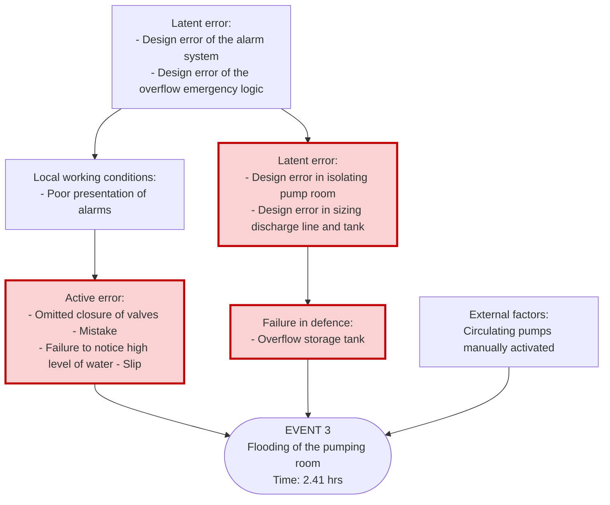

- **Dinamica.** Gli operatori hanno riattivato due volte le pompe di circolazione (**External factors: circulating pumps manually activated**) con le valvole di sfogo aperte: hanno spinto fuori una quantità d'acqua enorme, con una portata 4-5 volte superiore a qualsiasi valore considerato dai progettisti. Il sistema di scarico e il serbatoio di raccolta erano dimensionati solo per la normale condensa del vapore che può uscire dalle valvole di sicurezza, non per la portata massima delle pompe. Il serbatoio è traboccato (**Failure in defence: overflow storage tank**) e ha allagato la sala pompe.
- **Latent error tecnico:** *design error in sizing discharge line and tank* e *design error in isolating pump room*.
- **Il punto chiave dell'Evento 3: allineamento tra progettazione tecnica e progettazione organizzativa.** Nell'Evento 1 il tema era l'allineamento tra tecnologia operativa (OT) e flussi informativi; qui è tra decisioni di progetto tecnico e procedure/addestramento. Il serbatoio ha una dimensione finita: come si decide quanto farlo grande? Va allineata la dimensione fisica dello scarico con procedure e addestramento, in modo che gli operatori riescano a capire e risolvere (chiudere le valvole) **prima** che il serbatoio sia pieno. Se progettazione tecnica e comportamento umano restano disaccoppiati, nessuna dimensione del serbatoio sarà mai sufficiente. Per la regola dello scope of influence, questo fattore **va in alto**.
- **Active errors:** valvole non chiuse (*Omitted closure of valves*, **Mistake**) e alto livello dell'acqua non notato (*Failure to notice high level of water*, **Slip**, una svista).
- **Local working conditions:** *poor presentation of alarms* (l'allarme di alto livello era disperso in una lunga lista, HMI a finestre stratificate).
- **Latent error in alto:** *design error of the alarm system* e *design error of the overflow emergency logic*.

**Cosa abbiamo aggiunto nel minor (completamento):**

- in alto, il punto detto dal prof: "Discharge sizing not aligned with procedures and training";
- nella slide del prof il box *Personal/External factors* lato umano è vuoto; noi lo completiamo con "Attention focused on restoring flow" (coerente con la priorità di servizio e con l'abitudine di regolare la portata) e "Night shift" (nostra integrazione, basata sulla sezione 3.6 e sul ragionamento dell'Evento 1).

### 3.3 Le due domande metodologiche degli studenti

**Domanda 1: perché nell'Evento 3 non mettere "lack of training" tra i fattori umani?**

Risposta del prof, con il modello SRK: in astratto si potrebbe citare la mancanza di training per qualsiasi errore, ma va detto **quale tipo** di training.

- **Evento 1**: la mancanza di training è fondamentale, perché serviva operare a livello **rule-based** (seguire procedure di emergenza) e **knowledge-based** (conoscenze termodinamiche per diagnosticare che il DCS stava sbagliando).
- **Evento 3**: siamo a livello **skill-based**. Se vedi le valvole di sfogo aperte, controllare se la pressione è davvero alta e chiudere le valvole prima di riaccendere le pompe è un'operazione elementare (come cambiare marcia: non apri il manuale). È una competenza di base data dall'addestramento iniziale (*entry-level training*) e dall'esperienza, che deve essere supportata da un'interfaccia che mostri bene gli allarmi.
- Il prof precisa però che **non esiste un'unica analisi perfetta**: si può mettere il training anche nell'Evento 3 se si specifica che gli operatori si sono dimostrati inaffidabili persino a livello skill-based / entry-level. Lo strumento non è dogmatico: serve a un'analisi solida da cui trarre raccomandazioni. Il prof caricherà due soluzioni di due team diversi proprio per mostrare piccole differenze interpretative.

**Domanda 2: box laterali o box in alto?** È la regola dello **scope of influence** (sezione 1.10): un solo percorso, box laterale; entrambi i percorsi, box in alto.

---

## 4. Guida evento per evento

Per ogni evento: cosa succede, ragionamento box per box (coerente con gli schemi del minor), classificazioni, fonti. I box contrassegnati **[rosso]** sono quelli colorati nel minor secondo la convenzione della sezione 1.10.

### 4.0 Tabella di sintesi delle classificazioni (identica nel minor)

| Ev. | Swain e Guttman (fenotipo) | Reason | SRK | CREAM: effetto | Funzione cognitiva | Antecedenti generali | Antecedente specifico |
|---|---|---|---|---|---|---|---|
| 1 | Omission (nessuna diagnosi/intervento) | Mistake | Knowledge-based (+ rule-based mancante) | Timing, Omission | Observation / Interpretation | Inattention, Observation missed, Faulty diagnosis, Inadequate procedure | nessuno |
| 2 | Commission (wrong action) | Mistake rule-based ("pompe ferme, riaccendile") | Rule-based | Timing, Too early | Interpretation / Planning | Faulty diagnosis, Inadequate procedure | Earlier omission (E1) |
| 3 | Omission (valvole) + omission di rilevazione (allarme) | Mistake + Slip | Skill-based (prof) | Timing, Omission | Observation / Planning | Observation missed, Inattention | Earlier omission |
| 4 | Commission (too late) | Mistake (faulty diagnosis) | Knowledge-based | Timing, Too late | Interpretation | Faulty diagnosis, Observation missed, Inadequate procedure | Earlier omission |
| 5 | Nessun errore attivo diretto alle 03.20 (evento guidato dal sistema); contributo indiretto omission/too late | - | - | Timing, Too late (contenimento del rilascio di vapore) | Observation | Observation missed, Inadequate procedure | Earlier omission |
| 6 | Omission / too late (calore non isolato, bypass scambiatore in ritardo) | Mistake knowledge-based | Knowledge-based | Timing, Too late | Interpretation / Planning | Communication failure, Faulty diagnosis, Observation missed | Earlier omission |
| 7 | Violation (bypass protezione bassa pressione dopo 3 tentativi) + Mistake (riavvio senza ripressurizzare) | Violation + Mistake knowledge-based | Knowledge-based gestito come rule-based | Sequence, Jump forward | Planning | Faulty diagnosis, Inadequate plan, Inadequate procedure | nessuno identificato |
| 8 | Commission (timing) | Mistake knowledge-based + communication failure tra le due sale | Knowledge-based | Timing, Too early | Interpretation / Planning | Communication failure, Faulty diagnosis, Inadequate procedure | Earlier omission |
| 9 | Commission: ripressurizzazione di una rete bifase (E7 + E8) | Mistake knowledge-based (+ violation da E7) | Knowledge-based | Timing, Too early | Interpretation / Planning | Faulty diagnosis, Communication failure, Inadequate plan | Earlier omission |

### 4.1 Evento 2: avvio manuale delle pompe di circolazione principali (02.04 h)

**Cosa succede.** Quattro minuti dopo l'inizio della depressurizzazione, con la pressione reale in calo, le pompe di ricircolo principali vengono avviate manualmente dalla sala controllo, a giri minimi. Risultato: ulteriore vaporizzazione (testo, sezione 2, evento 2). Secondo il prof il riavvio è stato tentato due volte, con le valvole di sfogo aperte. È l'evento che rivela il mistake dell'Evento 1.

**Percorso dominante:** umano (l'evento è un'azione), con il lato sistema che la rende dannosa.

| Box | Contenuto nel minor | Perché / fonte |
|---|---|---|
| Active error **[rosso]** | Riavvio ripetuto delle pompe con valvole di sfogo aperte e pressione in calo, senza diagnosticare perché si erano fermate (Mistake, rule-based) | Evento 2; spiegazione del prof: priorità al servizio, riaccese "d'impulso" |
| Local working conditions | HMI senza visione d'insieme: la depressurizzazione non era evidente; nessuna procedura di emergenza; obiettivi in conflitto (ripristino del servizio vs stato sicuro) | §3.3, §3.4 |
| Personal / External factors | Bassa situational awareness; abitudine a controllare la portata e non la pressione / Turno di notte, carico di base stabile | spiegazione del prof (logica operativa, notte), §3.6 |
| Latent error in alto | Continuità del servizio come primo obiettivo operativo; errore di progetto del sistema di controllo (logica automatica non integrata con i comandi manuali) | §3.1 (obiettivo dichiarato); la seconda parte è nostra inferenza dal funzionamento descritto in §2 |
| Latent error sistema **[rosso]** | Nessun interlock tra stato di depressurizzazione e avvio manuale delle pompe; logica di controllo guidata da un unico segnale non validato | nostra inferenza (interlock); il sensore unico e senza triangolazione è dal prof |
| Failure in defence **[rosso]** | Depressurizzazione automatica ancora attiva sul falso segnale; nessuna barriera ha bloccato l'avvio delle pompe in bassa pressione | evento 1 e 2; mancanza della barriera: nostra inferenza |
| External factors (sistema) | Transitorio di depressurizzazione in corso (Evento 1) | evento 1 |

**Classificazione.** Commission (azione sbagliata). Mistake rule-based: è una regola "forte ma sbagliata" applicata senza diagnosi ("se le pompe sono ferme, riaccendile per non lasciare gli utenti al freddo"). Rule-based. CREAM: Timing, Too early (pompe riavviate prima di aver ripristinato la pressione), funzione Interpretation/Planning, antecedenti Faulty diagnosis e Inadequate procedure, specifico **Earlier omission** (la diagnosi mancata dell'Evento 1).

**Attenzione:** è molto vicino alla discussione dell'Evento 1 (il prof lo ha usato come "prova" del mistake di E1). Va bene, ma rischia di sembrare una ripetizione.

### 4.2 Evento 4: chiusura manuale delle valvole di sfogo in ritardo (03.00 h)

**Cosa succede.** La chiusura manuale delle valvole di sfogo e il bypass dello scambiatore di calore, cioè azioni di protezione essenziali, vengono eseguiti con **grande ritardo** (testo, evento 4): circa un'ora dopo l'apertura delle valvole (02.00) e circa 20 minuti dopo l'overflow (02.41).

**Percorso dominante:** entrambi (ritardo umano + valvole tenute aperte dalla logica automatica).

| Box | Contenuto nel minor | Perché / fonte |
|---|---|---|
| Active error **[rosso]** | Chiusura delle valvole e bypass dello scambiatore eseguiti troppo tardi (circa 1 h) (Mistake, faulty diagnosis) | evento 4; ritardo calcolato dalla timeline |
| Local working conditions | Valvole aperte e livello del serbatoio non evidenti nell'HMI stratificato; nessuna procedura di emergenza; supervisore che fa la spola tra le sale, squadra di turno sottodimensionata | §3.3, §3.4, §3.2, §3.1 |
| Personal / External factors | Nessuna conoscenza termoidraulica, nessuna esperienza di emergenza / Turno di notte, tempo disponibile limitato | §3.1, §3.7, §3.6, §3.5 |
| Latent error in alto | Mancanza di controllo centralizzato (due sale separate); errore di progetto del sistema di controllo e allarme | §3.1, §3.3 (pesano sia sull'informazione agli operatori sia sul comportamento del sistema) |
| Latent error sistema **[rosso]** | Valvole tenute aperte dalla logica automatica, nessuna richiusura automatica (bassa pressione / alto livello); nessun allarme per misura fuori range | §3.3 (abnormal measure); richiusura automatica assente: nostra inferenza |
| Failure in defence **[rosso]** | Valvole di sfogo lasciate aperte: scarico continuo di acqua e vapore | eventi 1, 3, 4 |
| External factors (sistema) | Acqua bollente e vapore nella sala pompe (Evento 3) | evento 3 |

**Classificazione.** Commission (troppo tardi: l'azione c'è, ma fuori tempo). Mistake per diagnosi sbagliata: non avevano capito che la depressurizzazione era causata da un falso segnale e che le valvole andavano richiuse. Knowledge-based. CREAM: Timing, Too late, funzione Interpretation, antecedenti Faulty diagnosis, Observation missed, Inadequate procedure, specifico Earlier omission.

**Leve di miglioramento:** sinottico unico, allarmi prioritizzati, procedura per il transitorio di depressurizzazione, logica di richiusura automatica, controllo centralizzato.

### 4.3 Evento 5: intervento dell'antincendio, black-out, telecontrollo perso (03.20 h)

**Cosa succede.** L'allagamento della sala pompe e la saturazione dell'aria con vapore fanno intervenire il sistema antincendio, che **non distingue vapore da fumo**: taglio completo dell'alimentazione, pompe ferme, **telecontrollo fuori servizio** (testo, evento 5). Da qui in poi gli operatori sono "ciechi" e devono gestire tutto sul campo.

**Percorso dominante:** sistema (come l'Evento 1). Alle 03.20 non c'è un'azione umana sbagliata: è una difesa automatica che interviene in modo spurio.

| Box | Contenuto nel minor | Perché / fonte |
|---|---|---|
| Active error (bianco) | Nessun errore attivo diretto alle 03.20; i ritardi precedenti (eventi 2-4) hanno lasciato saturare di vapore la sala pompe (Omission) | eventi 2-4 |
| Local working conditions | Nessuna videosorveglianza (impossibile verificare vapore vs incendio); nessuna procedura per lo scatto dell'antincendio durante un'emergenza di processo; squadra sottodimensionata | §3.3, §3.4, §3.1 |
| Personal / External factors | Stress, compiti concorrenti / Turno di notte, tempo limitato | §3.4 (compiti concorrenti), §3.5, §3.6 |
| Latent error in alto | Sistemi di protezione progettati in modo isolato (antincendio vs controllo di processo) | nostra inferenza: l'antincendio ignora lo stato del processo e taglia anche ciò che serve a gestirlo; pesa sia sul guasto sia sulle condizioni degli operatori |
| Latent error sistema **[rosso]** | Rilevatori che non distinguono vapore e fumo; il taglio di corrente ferma anche pompe e telecontrollo (il backup mantiene solo i set point) | evento 5; §2 (backup) |
| Failure in defence **[rosso]** | Intervento spurio dell'antincendio: black-out totale, pompe ferme, telecontrollo fuori servizio | evento 5 |
| External factors (sistema) | Sala pompe allagata e satura di vapore (eventi 3-4) | eventi 3-4 |

**Classificazione.** Nessun errore attivo diretto: la struttura è come l'Evento 1 (rosso solo lato sistema). Contributo indiretto: omission/too late nel contenere il rilascio. CREAM (sul contributo indiretto): Timing, Too late, funzione Observation, antecedenti Observation missed e Inadequate procedure, specifico Earlier omission.

**Perché è interessante:** è il miglior esempio del corso di **difese che interagiscono male** (una barriera di sicurezza, l'antincendio, distrugge un'altra barriera, il telecontrollo e quindi la situational awareness). Ottimo per parlare di progettazione integrata delle protezioni. Meno ricco di errori umani.

### 4.4 Evento 6: aumento della temperatura in uscita dagli scambiatori (03.45 h)

**Cosa succede.** Ulteriore aumento della temperatura dell'acqua, in uscita dagli scambiatori di calore, dovuto alla fuoriuscita e miscelazione dell'acqua nel sistema (testo, evento 6). Nella slide 5 è nel gruppo "vaporizzazione dovuta allo scambio termico" insieme a 4 e 8, alimentato dall'evento 5 (pompe ferme). Il bypass dello scambiatore (parte dell'evento 4) era stato fatto in ritardo.

**Percorso dominante:** entrambi (calore non isolato + perdita di rimozione del calore).

| Box | Contenuto nel minor | Perché / fonte |
|---|---|---|
| Active error **[rosso]** | Apporto di calore non isolato in tempo: bypass dello scambiatore in ritardo, trasferimento di calore non ridotto con la circolazione ferma (Mistake, knowledge-based) | evento 4 (bypass in ritardo), evento 5 (pompe ferme) |
| Local working conditions | Telecontrollo fuori servizio: nessuna misura della rete; supervisore che fa la spola tra le sale; nessuna procedura di emergenza | evento 5, §3.2, §3.4 |
| Personal / External factors | Nessuna conoscenza termoidraulica (vaporizzazione da scambio termico non prevista) / Turno di notte; attenzione assorbita dalle azioni sul campo | §3.1, §3.6; il secondo punto è nostra inferenza |
| Latent error in alto | Mancanza di controllo centralizzato: generazione e rete gestite da due sale; progetto del sistema di controllo: perdendo il telecontrollo si perde la vista su tutta la rete | §3.1, evento 5 |
| Latent error sistema **[rosso]** | Nessun interlock automatico che riduca l'apporto di calore in caso di perdita di circolazione; bypass dello scambiatore dipendente da un'azione manuale | **nostra inferenza** (interlock assente e bypass solo manuale dedotti dal testo, che parla di bypass manuale in ritardo) |
| Failure in defence **[rosso]** | Perdita della rimozione di calore: pompe ferme (evento 5) mentre il calore continuava a essere trasferito | eventi 5-6 |
| External factors (sistema) | Fuoriuscita e miscelazione dell'acqua nel sistema | evento 6 |

**Classificazione.** Omission / too late. Mistake knowledge-based (serviva capire che, senza circolazione, il calore residuo porta la rete calda e a bassa pressione verso l'ebollizione). CREAM: Timing, Too late, funzione Interpretation/Planning, antecedenti Communication failure (due sale), Faulty diagnosis, Observation missed (niente telecontrollo), specifico Earlier omission.

**Attenzione:** il testo su questo evento è scarno (una riga). Molti box sono inferenze: se lo scegliete, nelle giustificazioni dichiaratelo.

### 4.5 Evento 7: avvio delle pompe bypassando la protezione di bassa pressione (04.39 h)

**Cosa succede.** Attivazione manuale delle pompe di ricircolo **bypassando la protezione di bassa pressione delle pompe**; prima ci sono stati **tre tentativi** di avvio. Effetto: ulteriore riduzione della pressione, seguita da una **violenta pressurizzazione** (testo, evento 7). Nella slide 5 è il "picco di pressurizzazione", alimentato dall'evento 5 (operazioni locali, senza telecontrollo).

**Percorso dominante:** entrambi, con un errore umano molto caratteristico (violazione).

| Box | Contenuto nel minor | Perché / fonte |
|---|---|---|
| Active error **[rosso]** | Protezione di bassa pressione bypassata deliberatamente dopo tre avvii falliti (Violation); pompe riavviate senza prima ripressurizzare la rete (Mistake) | evento 7 |
| Local working conditions | Operazione manuale locale nella sala pompe allagata (modo manuale usato raramente); nessuna procedura di emergenza o di riavvio; nessun monitoraggio remoto (telecontrollo perso) | §1.2.1, §3.4, evento 5; sala allagata dal prof |
| Personal / External factors | Nessuna conoscenza termoidraulica; fatica e stress dopo 2,5 h di emergenza / Turno di notte, pressione del tempo | §3.1, §3.5, §3.6; **la fatica è nostra inferenza** dalla timeline (02.00-04.39) |
| Latent error in alto | Continuità del servizio che prevale sulla sicurezza (safety culture); gestione debole delle barriere di sicurezza (bypass possibile senza autorizzazione) | §3.1, §3.4 (obiettivi in conflitto); la seconda parte è nostra inferenza: pesa sia sul progetto (bypass possibile) sia sul comportamento (bypass accettato) |
| Latent error sistema **[rosso]** | Protezione bypassabile localmente senza consenso (permissive); nessuna sequenza di riavvio sicura nel progetto (ripressurizzare prima di avviare le pompe) | **nostra inferenza** dal fatto che il bypass sia stato possibile |
| Failure in defence **[rosso]** | Protezione di bassa pressione delle pompe resa inefficace | evento 7 |
| External factors (sistema) | Rete ancora bifase, con sacche di vapore (eventi 5-6) | eventi 5-6, fisica del colpo d'ariete |

**Classificazione.** **Violation** (Swain e Guttman e Reason): deviazione deliberata ma non malevola, motivata dal ripristino del servizio. Insieme, un **mistake knowledge-based**: non sapevano che ripressurizzare una rete bifase genera il colpo d'ariete. SRK: situazione knowledge-based (nuova, servivano conoscenze termoidrauliche) affrontata come se fosse rule-based ("se la pompa non parte, togli il blocco"). CREAM: Sequence, Jump forward (saltato il passo di ripressurizzazione prima dell'avvio), funzione Planning, antecedenti Faulty diagnosis, Inadequate plan, Inadequate procedure, specifico nessuno identificato.

**Perché è un ottimo evento per il minor:** è l'unico con una **violazione** chiara, è molto diverso da E1 ed E3, e permette di discutere safety culture, gestione dei bypass e il caso "le procedure non sono la Bibbia" (qui le procedure proprio mancavano).

### 4.6 Evento 8: avvio manuale del recupero termico dal turbo-gas (05.15 h)

**Cosa succede.** Viene avviato il recupero termico dal sistema turbo-gas (testo, evento 8). Secondo il prof gli operatori della centrale hanno così immesso altro calore in un tubo già a bassa pressione e pieno di vapore (seconda vaporizzazione).

**Percorso dominante:** entrambi, con al centro il **coordinamento tra le due sale controllo**.

| Box | Contenuto nel minor | Perché / fonte |
|---|---|---|
| Active error **[rosso]** | Recupero termico avviato mentre la rete era depressurizzata e bifase (Mistake, knowledge-based) | evento 8, spiegazione del prof |
| Local working conditions | Nessuna visione condivisa tra sala centrale e sala rete; telecontrollo della rete fuori servizio; nessuna procedura di riavvio post-emergenza | §3.1 (controllo non centralizzato), evento 5, §3.4 |
| Personal / External factors | Nessuna conoscenza termoidraulica; fatica dopo 3 h di emergenza / Turno di notte; pressione per ripristinare il riscaldamento | §3.1, §3.6; **fatica e pressione per la domanda del mattino sono nostra inferenza** (05.15, verso l'aumento della domanda mattutina) |
| Latent error in alto | Mancanza di controllo centralizzato: decisioni incoerenti tra le due sale; continuità del servizio come primo obiettivo | §3.1 (lo dice esplicitamente: "misunderstanding and incoherent decisions") |
| Latent error sistema **[rosso]** | Nessun interlock tra avvio del recupero termico e stato della rete (pressione, portata); funzioni del turbo-gas in parte controllate da una sala non presidiata | interlock: **nostra inferenza**; sala non presidiata: §1.3 |
| Failure in defence **[rosso]** | Nessun consenso (permissive) ha bloccato l'avvio: calore extra in un circuito a bassa pressione pieno di vapore | eventi 6-8; mancanza del permissive: nostra inferenza |
| External factors (sistema) | Rete depressurizzata, sacche di vapore presenti (eventi 6-7) | eventi 6-7 |

**Classificazione.** Commission (timing: azione giusta in sé, ma nel momento sbagliato). Mistake knowledge-based + **communication failure** tra le due sale. CREAM: Timing, Too early, funzione Interpretation/Planning, antecedenti Communication failure, Faulty diagnosis, Inadequate procedure, specifico Earlier omission.

**Perché è un ottimo evento per il minor:** è quello che mette meglio in luce il fattore organizzativo più citato nel testo (mancanza di controllo centralizzato) e il rimedio adottato davvero dopo l'incidente (sale controllo unificate).

### 4.7 Evento 9: onda d'urto, colpo d'ariete (06.15 h)

**Cosa succede.** Si genera un'onda d'urto violentissima: ancoraggio spostato di 90 mm e deformato, forza 35-45 t, picco 3-4 MPa, danni interni agli scambiatori (testo, evento 9). È l'unica manifestazione immediata dell'incidente e il punto in cui convergono tutte le fasi.

| Box | Contenuto nel minor | Perché / fonte |
|---|---|---|
| Active error **[rosso]** | Rete bifase ripressurizzata senza sfiatare o condensare il vapore: pompe riavviate (E7) e calore immesso (E8) (Mistake, knowledge-based) | eventi 7-8, fisica |
| Local working conditions | Nessuna consapevolezza delle sacche di vapore (niente visione d'insieme, niente telecontrollo); nessuna procedura di emergenza; obiettivi in conflitto | §3.3, §3.4, evento 5 |
| Personal / External factors | Nessuna conoscenza per prevedere un'onda d'urto; fatica dopo 4 h di emergenza / Turno di notte, stress cumulato | §3.1 (lo dice testualmente), §3.6; **fatica: nostra inferenza** |
| Latent error in alto | Cultura production-first, squadre sottodimensionate e non formate, nessuna procedura di emergenza; mancanza di controllo centralizzato | §3.1, §3.4, §3.7 |
| Latent error sistema **[rosso]** | Nessuna misura progettuale contro il colpo d'ariete (protezione dai picchi, sfiati, ripressurizzazione controllata); logica di controllo a sensore singolo (origine del transitorio) | nostra inferenza (misure anti colpo d'ariete); sensore singolo dal prof |
| Failure in defence **[rosso]** | Protezione di bassa pressione bypassata; sistema di pressurizzazione incapace di assorbire un picco di 3-4 MPa | eventi 7, 9 |
| External factors (sistema) | Collasso delle sacche di vapore nella tubazione principale | fisica, evento 9 |

**Classificazione.** Evento finale (top event). Commission: ripressurizzazione di una rete bifase (E7 + E8). Mistake knowledge-based (+ violation da E7). CREAM: Timing, Too early, funzione Interpretation/Planning, antecedenti Faulty diagnosis, Communication failure, Inadequate plan, specifico Earlier omission.

**Attenzione:** analizzare il top event tende a **ripetere** gli eventi precedenti (è la somma di tutto). È utile per lo studio (mostra l'allineamento dei buchi del formaggio), meno consigliabile per il minor.

---

## 5. Quali eventi scegliere

| Evento | Percorso dominante | Tipo di errore | Ricchezza HOF | Sovrapposizione con E1/E3 | Consiglio |
|---|---|---|---|---|---|
| E2 | umano | mistake rule-based | media | **alta** (il prof lo usa per spiegare E1) | alternativa |
| E4 | entrambi | mistake, too late | alta | media (allarmi e HMI come E3) | possibile |
| E5 | sistema | nessun errore attivo diretto | media (molto design) | bassa | alternativa se volete un evento "di progetto" |
| E6 | entrambi | omission / too late | media | bassa, ma testo scarno e molte inferenze | sconsigliato |
| E7 | entrambi | **violation** + mistake knowledge-based | **molto alta** | **bassa** | **consigliato** |
| E8 | entrambi | mistake + communication failure | **alta** (controllo non centralizzato) | **bassa** | **consigliato** |
| E9 | entrambi | somma degli eventi | alta ma ripetitiva | alta con tutto | sconsigliato |

**Nostro suggerimento: E7 + E8.** Coprono due meccanismi diversi tra loro e diversi da E1/E3: E7 è l'operatore sul campo che viola una protezione (safety culture, gestione dei bypass, livello knowledge-based); E8 è il coordinamento tra le due sale controllo (fattore organizzativo esplicito nel testo, con il rimedio reale delle sale unificate).

**Alternative:** E2 (molto vicino alla discussione di E1, quindi facile da giustificare ma meno originale) oppure E5 (dominato dal sistema: progettazione e integrazione delle protezioni, ottimo per il collegamento con la sicurezza OT).

---

## 6. Checklist finale ed errori tipici

### 6.1 Checklist per ogni evento

- [ ] Il box **Event** contiene il sotto-evento giusto con l'ora (non l'intero incidente).
- [ ] C'è almeno un **active failure**: errore attivo umano e/o guasto di una difesa. Se l'errore attivo non c'è (E1, E5), lo dico esplicitamente.
- [ ] Ogni errore attivo ha la **classificazione** (Mistake / Slip / Lapse / Violation) e, nelle giustificazioni, Swain e Guttman e livello SRK.
- [ ] Le **local working conditions** spiegano perché l'errore è avvenuto *lì* (HMI, allarmi, procedure, staffing).
- [ ] I fattori **personali ed esterni** lato umano sono separati da quelli **lato sistema** (es. turno di notte a sinistra, temperatura esterna a destra).
- [ ] Il **box in alto** contiene solo fattori che pesano su **entrambi** i percorsi.
- [ ] Ogni box ha una **fonte** nelle giustificazioni (sezione del caso o discussione in aula); le inferenze sono dichiarate.
- [ ] Colori coerenti: rosso solo sulla catena causale diretta.
- [ ] Una pagina di template + al massimo una di giustificazioni.

### 6.2 Errori tipici

- **Mettere "lack of training" ovunque** senza dire quale livello SRK manca (skill, rule o knowledge). Il prof lo ha discusso proprio su E1 vs E3.
- **Confondere box in alto e box laterali**: un fattore che pesa solo sul lato tecnico non va in alto.
- **Dimenticare i fattori esterni lato sistema** (condizioni di processo o ambientali intorno alla difesa: temperatura, rete bifase, sala allagata).
- **Confondere fenotipo e genotipo**: "non ha chiuso le valvole" è il fenotipo (omission); "non aveva capito la situazione" è il genotipo (mistake, faulty diagnosis).
- **Classificare "too late" come omission**: in Swain e Guttman è commission (azione eseguita male).
- **Scambiare "mistake" per "azione intenzionale"**: mistake vuol dire errore nell'intenzione/diagnosi, non "di proposito". Il "di proposito" è la violation.
- **Cercare il colpevole**: l'analisi deve portare a raccomandazioni di sistema, non a un giudizio sull'operatore.
- **Inventare informazioni**: la sezione 3.8 (team) è vuota, non riempirla con fantasie.
- **Usare 1 metro invece di 90 mm** per lo spostamento della tubazione.

---

## 7. Glossario IT/EN

| Inglese | Italiano | Significato nel caso |
|---|---|---|
| Co-generation plant | impianto di cogenerazione | produce elettricità e calore insieme |
| District heating / Heating distribution network (HDN) | teleriscaldamento / rete di distribuzione del calore | rete cittadina di acqua calda |
| Water hammer | colpo d'ariete | onda d'urto dovuta al collasso di sacche di vapore |
| Shock wave | onda d'urto | evento 9 |
| Two-phase flow | flusso bifase | acqua + vapore nello stesso tubo |
| Steam pocket / void | sacca di vapore | intrappolata tra creste d'acqua |
| Depressurisation transient | transitorio di depressurizzazione | evento 1 |
| Pressure transducer | trasduttore (sensore) di pressione | il componente guasto |
| Relief valve | valvola di sfogo / di sicurezza | aperta dal DCS sul falso segnale |
| Expansion tank | vaso di espansione | assorbe le variazioni di volume/pressione |
| Storage / overflow tank | serbatoio di raccolta | traboccato nell'evento 3 |
| Heat exchanger | scambiatore di calore | danneggiato dall'onda d'urto |
| Condenser | condensatore | scambiatore a fine ciclo della centrale, sostituito dopo l'incidente |
| Main feed / circulation pumps | pompe di alimentazione / circolazione principali | regolano la portata |
| Pressurising pumps | pompe di pressurizzazione | regolano la pressione |
| Flow rate | portata | grandezza regolata per seguire la domanda |
| Set point | valore di riferimento | valore impostato che il controllo automatico mantiene |
| DCS (Distributed Control System) | sistema di controllo distribuito | il controllo automatico dell'impianto |
| HMI (Human-Machine Interface) | interfaccia uomo-macchina | schermate e allarmi per l'operatore |
| VDU (Video Display Unit) | monitor/terminale video | usati nella sala controllo della rete |
| Synoptic panel | quadro sinottico | visione d'insieme dell'impianto |
| Tele-operating system / tele-control | sistema di telecontrollo | controllo remoto della rete |
| Interlock | interblocco | blocco automatico che impedisce un'azione in condizioni non sicure |
| Permissive | consenso | condizione che deve essere vera perché un'azione sia permessa |
| By-pass (of a protection) | esclusione / bypass di una protezione | evento 7 |
| Low-pressure protection | protezione di bassa pressione | impedisce l'avvio delle pompe con pressione troppo bassa |
| Fire protection system | sistema antincendio | evento 5 |
| Back-up power | alimentazione di riserva | manteneva solo i set point |
| Base load | carico di base | domanda notturna minima e stabile |
| Situational awareness | consapevolezza situazionale | sapere cosa sta succedendo e cosa succederà |
| Data triangulation | triangolazione dei dati | verificare un dato con grandezze correlate |
| Defence-in-depth | difesa in profondità | difese a strati |
| Active / latent failure | errore attivo / latente | sincrono vs dormiente |
| Local working conditions | condizioni di lavoro locali | precondizioni dell'errore |
| Organisational vulnerabilities | vulnerabilità organizzative | box in alto del template |
| Near miss | quasi-incidente | evento senza conseguenze gravi |
| Phenotype / genotype | fenotipo / genotipo | manifestazione / causa dell'errore |
| Error mode | modo di errore | forma osservabile dell'errore (CREAM) |
| Antecedent | antecedente | causa tipica di un error mode (CREAM) |
| Night shift | turno di notte | fattore esterno lato umano |
| Entry-level training | addestramento iniziale | base delle abilità skill-based |
| On-the-job training | formazione sul campo | l'unica ricevuta dagli operatori (§3.7) |
